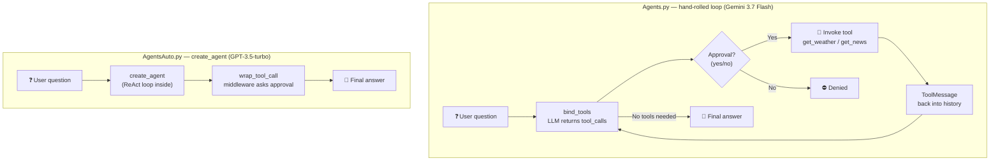

# 🤖 Agent Project — LangChain Learning Lab

My hands-on path into agentic AI: LCEL runnables, custom tools, and tool-calling agents — each file is one concept, built and run.

The centerpiece is a **City Intelligence assistant**: ask about any city and it fetches live weather (OpenWeather) plus the latest news (Tavily) — built twice, two different ways.

## ✨ What's inside

| File | What it does |
|---|---|
| `Agents.py` | City assistant with a **hand-rolled agent loop** — `bind_tools`, manual `tool_calls` handling, `ToolMessage` feedback, human approval before every call (Gemini 3.7 Flash) |
| `AgentsAuto.py` | The same assistant rebuilt with **`create_agent`** (GPT-3.5-turbo) + `wrap_tool_call` middleware for approval |
| `toolcalling.py` | Tool-calling basics: one toy tool (`get_text_length`), one manual tool-call round |
| `owntool.py` | Building a custom tool with the `@tool` decorator |
| `newssummarizer.py` | Tavily news search → GPT-3.5-turbo chain that summarizes news into bullet points |
| `parallelrunnable.py` | LCEL: `RunnableParallel` — short + detailed explanation of a topic in one call |
| `sequencerunnable.py` | LCEL basics: `prompt \| model \| parser` chain |
| `runnablepassthrough.py` | LCEL: generate code, then `RunnablePassthrough` keeps the code while a parallel branch explains it |

## 🏗️ The two agent flavors



## 🚀 Quickstart

```bash
pip install -r requirements.txt
```

Create a `.env` file (never commit this):

```
TAVILY_API_KEY=your-key-here
OPENWEATHER_API_KEY=your-key-here
GOOGLE_API_KEY=your-key-here
OPENAI_API_KEY=your-key-here
```

Then run any file:

```bash
python Agents.py       # manual-loop city assistant (type exit to quit)
python AgentsAuto.py   # create_agent city assistant (type exit to quit)
```

## 🧠 Design Decisions

| Choice | Why |
|---|---|
| **Manual loop before `create_agent`** | `Agents.py` does the machinery by hand — `bind_tools` → check `tool_calls` → invoke → append `ToolMessage` → loop. Once you feel that loop, `create_agent` stops being magic. |
| **Human approval in both versions** | `Agents.py` asks inline (`Approve (yes/no)`); `AgentsAuto.py` does it properly with `wrap_tool_call` middleware. No surprise API calls while learning. |
| **Two different models** | The manual loop runs on Gemini 3.7 Flash, the `create_agent` version on GPT-3.5-turbo — proving tools are model-agnostic: the same `@tool` functions work with any chat model. |
| **One file per concept** | This is a learning repo: each file isolates one idea so it can be read, run, and understood alone. |
| **Tavily for search/news** | Built for LLMs — clean snippets instead of raw search-engine HTML. |

## 🛠️ Tech Stack

Python · LangChain (`create_agent`, LCEL, `@tool`) · Google Gemini 3.7 Flash · OpenAI GPT-3.5-turbo · Tavily · OpenWeather · Python-dotenv

## 🎓 What I learned

- Tool-calling anatomy: `bind_tools` → the model returns `tool_calls` → you invoke the tool → feed back a `ToolMessage` → repeat. That loop *is* the agent.
- `create_agent` is that same ReAct loop (Thought → Action → Observation), packaged — with middleware hooks like `wrap_tool_call` for cross-cutting concerns such as approval.
- Agents vs chains: agents decide and act; chains follow a fixed prompt. Use agents when the path isn't known upfront.
- LCEL runnables: `RunnableParallel`, `RunnablePassthrough`, and `RunnableLambda` compose like building blocks; `prompt | model | parser` is all a chain is.
- Custom tools: the `@tool` decorator turns any Python function into something an agent can call — the docstring becomes the model's instruction manual.

## ⚠️ Known limitation

`get_weather` hardcodes `,IN` (India) in the OpenWeather query, so it only resolves Indian cities correctly today. Removing that suffix (or making it a parameter) makes it worldwide.
